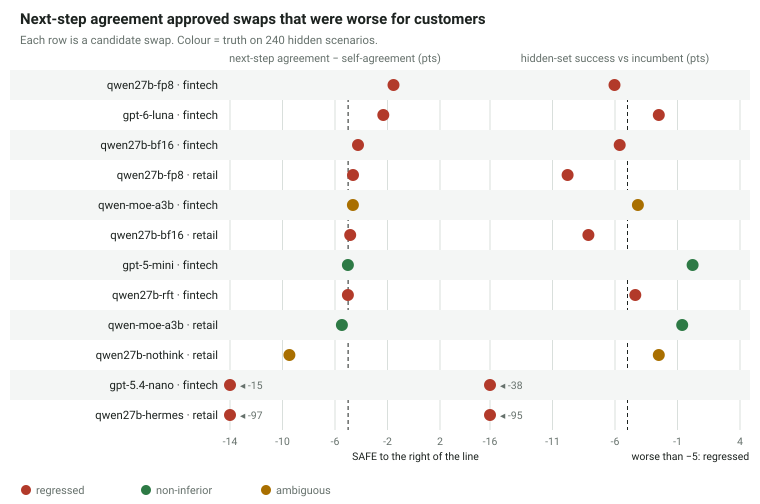
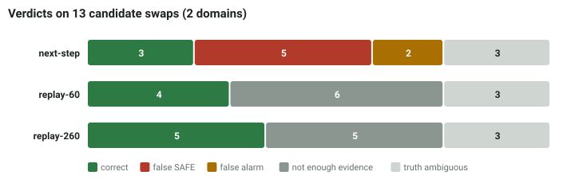
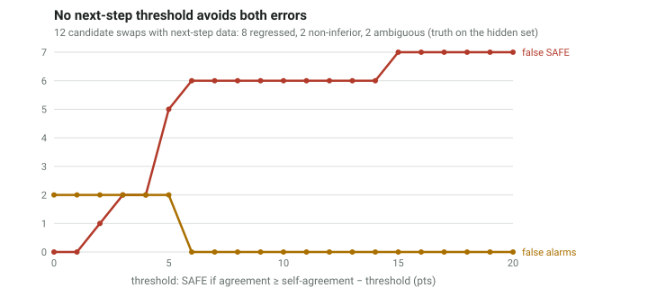
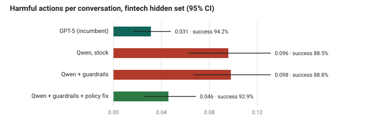

# Can you swap the model behind your support agent? Checking with replays, not imitation

*SwapBench draft write-up, October 2026. Every number below is computed from the per-conversation results in
[`results/`](../results/runs) by the scripts named in each section.*

## Summary

Teams want to move production agents from a frontier model to something cheaper, such as a smaller API model or a
self-hosted open model. The common way to vet such a swap is to replay the old model's recorded conversations and check
whether the new model makes the same next move. We tested that check against ground truth on two simulated support
agents: a retail store and a bank. In each, many cheaper models were compared with the current one on 240 hidden
scenarios.

- **Next-step agreement was wrong in both directions.**
  - It approved 5 of the 8 swaps that made the agent worse (verdicts on 10 decidable swaps across both domains).
  - It rejected 2 of 2 safe swaps.
  - No threshold avoids both errors: strict enough to catch every regression, it rejects every safe swap.
- **Replaying whole conversations was never wrong when it gave a verdict.** The method: a simulated customer, a stateful copy
  of the tools, and grading by the end state.
  - On 260 scenarios it gave 5 correct verdicts and said "not enough evidence" on the other 5 decidable swaps.
  - It made 0 false safe calls and 0 false alarms.
- **Close calls need many scenarios.**
  - Clear regressions are visible in 8–150 scenarios.
  - Swaps within a few points of the margin need 500–1,000. That is more than a team's logs or a fixed test set usually provide.
- **The cause of a regression is often cheap to fix once replay shows it.**
  - Example: a self-hosted Qwen3.8-27B lost 5.6 points against GPT-5 in the bank agent. Most of its harmful actions were
    offering customers a transfer to a human.
  - A three-line policy clarification made it non-inferior on the hidden set and on 200 scenarios we had not inspected,
    at about one-ninth of GPT-5's cost per conversation.
  - Fine-tuning on the model's own successful conversations did not help.
- **The tools can be inferred from traces.** An agent given only the incumbent's recorded conversations (25–50 are
  enough here) built tool mocks that reproduce 98–100% of tool outputs and every swap verdict. What traces don't
  settle is the grading rule, which the customer has to confirm.

## Setup

**Agents and tasks.** Two customer-support domains run in [tau2-bench](https://github.com/sierra-research/tau2-bench):
- **Retail:** tau2's store, with requests generated by us.
- **Fintech:** our bank domain "Northbank".
  - Seven tools: verify identity, accounts, transactions, refunds, disputes, card freezes, handover to a human.
  - A written policy: identity first, a $40 fee-refund cap, a 60-day dispute window, duplicate-charge rules, escalation rules.
  - Money-moving calls are recorded, never executed.

**Scenarios with ground truth by construction.** A generator plants a situation in the data (a duplicate charge, an
ineligible fee, a lost card, a delivered order) and writes the simulated customer's instructions and the exact tool
calls a correct agent must make.
- 60% of fintech scenarios chain two or three requests.
- A conversation passes if the final state of the tools equals the state after the correct calls.
- A *harmful action* is a successful write that the correct resolution does not contain.
- Each domain has 500 scenarios: 60 visible, 200 pool and 240 hidden.

**Simulated customer.** Claude Haiku 5.5 plays the customer from the scenario's instructions (see *Limitations*).

**Incumbents and candidates.**

| domain | incumbent | candidates |
|---|---|---|
| fintech | GPT-5 | GPT-5 mini, GPT-6 Luna, GPT-5.4 nano; Qwen3.8-27B (BF16 and FP8) and Qwen3.6-35B-A3B on vLLM; a fine-tuned Qwen |
| retail | Claude Haiku 5.5 | Qwen3.8-27B in four serving configurations (BF16, FP8 checkpoint, thinking off, generic tool parser), Qwen3.6-35B-A3B (MoE), and Haiku re-run against itself |

**Truth.** For each candidate:
- We take the success difference on the 240 hidden scenarios, 2 trials each, with a paired cluster bootstrap over scenarios.
- **REGRESSED:** a drop of 5 points or more, or a significant rise in harmful actions.
- **NON-INFERIOR:** the lower 95% bound is above −5 and harm does not rise.
- Otherwise **AMBIGUOUS**.

**Verifiers.**
- **Next-step agreement:** the candidate sees each recorded prefix of the incumbent's visible conversations and produces
  its next action. SAFE if its tool-call agreement is within 5 points of the incumbent's agreement with itself.
- **Replay-60 / replay-260:** full conversations on the 60 visible (or 60 + 200 pool) scenarios. SAFE / UNSAFE / NOT
  ENOUGH EVIDENCE from the paired 95% CI, the same margin and the same harm rule.

## Results

### Headline numbers (hidden set, 240 scenarios × 2 trials, 95% CIs)

From [`experiments/headline.md`](../experiments/headline.md) (`scripts/headline.py`):

| domain | model | success | harmful actions / conv. | Δ success vs incumbent | truth |
|---|---|---|---|---|---|
| fintech | GPT-5 (incumbent) | 94.2% [91.7, 96.5] | 0.031 [0.017, 0.048] | | |
| fintech | GPT-5 mini | 94.4% [92.1, 96.2] | 0.048 [0.031, 0.069] | +0.2 [−2.5, +2.9] | non-inferior |
| fintech | GPT-6 Luna | 91.7% [89.0, 94.2] | 0.073 [0.048, 0.100] | −2.5 [−5.4, +0.4] | regressed (harm) |
| fintech | GPT-5.4 nano | 56.7% [51.5, 61.9] | 0.454 [0.390, 0.521] | −37.5 [−42.9, −32.1] | regressed |
| fintech | Qwen3.8-27B | 88.5% [85.0, 91.9] | 0.096 [0.062, 0.131] | −5.6 [−8.8, −2.5] | regressed |
| fintech | Qwen3.8-27B FP8 | 88.1% [84.6, 91.5] | 0.098 [0.067, 0.133] | −6.0 [−9.4, −2.9] | regressed |
| fintech | Qwen3.6-35B-A3B | 90.0% [86.7, 92.9] | 0.060 [0.035, 0.087] | −4.2 [−7.9, −0.4] | ambiguous |
| retail | Haiku 5.5 (incumbent) | 95.4% [93.3, 97.3] | 0.013 [0.002, 0.025] | | |
| retail | Qwen3.8-27B | 87.3% [83.8, 90.6] | 0.027 [0.010, 0.046] | −8.1 [−12.1, −4.4] | regressed |
| retail | Qwen3.8-27B FP8 | 85.6% [81.9, 89.0] | 0.019 [0.008, 0.031] | −9.8 [−13.8, −6.0] | regressed |
| retail | Qwen3.6-35B-A3B | 94.8% [92.1, 97.1] | 0.004 [0.000, 0.010] | −0.6 [−3.3, +2.1] | non-inferior |
| retail | Qwen3.8-27B, thinking off | 92.9% [90.4, 95.2] | 0.010 [0.002, 0.021] | −2.5 [−5.4, +0.2] | ambiguous |
| retail | Qwen3.8-27B, generic tool parser | 0.4% [0.0, 1.2] | 0.000 | −95.0 [−97.1, −92.7] | regressed |

### Verifiers against the truth

Across the 13 candidate swaps (3 have ambiguous truth, which leaves 10 decidable):

| verifier | correct | false SAFE | false alarm | not enough evidence |
|---|---|---|---|---|
| next-step agreement (5-pt threshold) | 3 | **5** | 2 | (never abstains) |
| full replay, 60 scenarios | 4 | 0 | 0 | 6 |
| full replay, 260 scenarios | 5 | 0 | 0 | 5 |

The five false safes:
- Qwen3.8-27B BF16 and FP8 in retail (−8.1, −9.8);
- Qwen3.8-27B BF16 and FP8 in fintech (−5.6, −6.0);
- GPT-6 Luna in fintech, which takes more harmful actions.

The two false alarms are GPT-5 mini in fintech and the Qwen MoE in retail. Both are non-inferior on the hidden set.

**Threshold sweep.** Moving the next-step cut-off does not fix it.
- At 0–1 points it rejects everything, including both good swaps.
- From 2 points up it approves regressions: 5 at the usual 5 points, and 6–7 at looser thresholds.

Next-step agreement measures imitation. A model can match the incumbent's next tool call 92.6% of the time (FP8 Qwen in
retail) and still resolve 10% fewer requests: small deviations compound over 10–30 turns, and the customer reacts to them.

### How many scenarios a verdict needs

From [`experiments/sample_size.md`](../experiments/sample_size.md): the scenarios a paired 95% CI needs to clear the
margin, at the observed effect and spread.

| case | scenarios needed |
|---|---|
| a clear regression (GPT-5.4 nano, −37.5) | 8 |
| Qwen FP8 retail (−10.7 over 500 scenarios), GPT-5 mini fintech (−0.9) | ~150 |
| near the margin: GPT-6 Luna (−2.4), Qwen thinking off (−3.2) | 470–940 |

Replay-260 abstained on exactly the near-margin cases. A practical verifier should say how many more scenarios it needs,
and a scenario generator should be able to supply them.

### From "unsafe" to a safe swap: diagnose, fix, verify

From [`experiments/fix_loop_fintech.md`](../experiments/fix_loop_fintech.md):
- **Diagnosis.** Of stock Qwen's 46 harmful actions on the fintech hidden set, 39 were transfers to a human that policy
  does not allow, and in 33 of those Qwen had offered the transfer itself. Money rules were almost never broken.
- **Fix 1: hard guardrails in the tools** (identity, caps, windows). Blocked 12 calls; outcomes unchanged.
- **Fix 2: a three-line policy clarification** ("don't offer a human; 'not eligible' is a complete answer"):

| | success | harmful / conv. | Δ vs GPT-5 | truth |
|---|---|---|---|---|
| hidden set (where the cause was found) | 92.9% | 0.046 | −1.2 [−4.0, +1.5] | non-inferior |
| 200 pool scenarios never inspected | 93.0% | 0.033 | −0.5 [−4.2, +3.5] | non-inferior |

**Cost per conversation:**
- **GPT-5:** 7.2¢ at list prices.
- **The fixed Qwen:** about 0.8¢ in measured GPU time on one H100 at 12 concurrent conversations. That excludes
  engineering and operations, and higher concurrency would be cheaper.

The sample [Swap Report](../reports/fintech/index.html) shows the whole fintech comparison on one page
(`scripts/swap_report.py`).

### Fine-tuning on the model's own successes did not help

From [`experiments/rft_fintech.md`](../experiments/rft_fintech.md). One epoch of LoRA on 1,134 examples taken from
Qwen's own correct, harmless fintech conversations:

| | stock | tuned | Δ [95% CI] |
|---|---|---|---|
| success | 88.5% | 89.8% | +1.3 [−1.9, +4.4] |
| harmful actions / conv. | 0.096 | 0.092 | −0.004 [−0.035, +0.027] |
| next-step agreement with GPT-5 | 85.7% | 84.9% | −0.8 |
| output tokens / conv. | 2,341 | 2,047 | −294 [−381, −211] |

Neither the outcomes nor the imitation score moved. Only the reasoning got shorter. A training signal aimed at the
failures, or reinforcement learning against the simulator's end-state reward, would be the next test. The policy fix
above was far cheaper.

### Is the FP8 drop a configuration bug?

No, and it is mostly not FP8 ([`experiments/fp8_vs_bf16.md`](../experiments/fp8_vs_bf16.md)). We ran the BF16 checkpoint
with an identical serving setup on the same hidden retail scenarios:

| retail, 240 × 2 | Δ vs Haiku |
|---|---|
| Qwen3.8-27B BF16 | −8.1 [−12.1, −4.4] |
| Qwen3.8-27B FP8 | −9.8 [−13.8, −6.0] |
| FP8 vs BF16 | −1.7 [−5.4, +2.1] |

- **Transcripts:** they show no serving failures. There are no tool calls left as text, no empty replies, and fewer tool errors than the incumbent.
- **Fintech agrees:** FP8 −6.0 vs BF16 −5.6.
- **The cause:** the regression is the open model itself.
- **The serving change that did break things** was the tool parser: vLLM's generic `hermes` parser silently broke 95% of conversations.

### Can the tools be inferred from traces?

The replays above ran against hand-written copies of each domain's tools. A customer won't have those. We tested whether
an agent can infer them from the incumbent agent's recorded conversations alone
([`experiments/inferred_mocks.md`](../experiments/inferred_mocks.md)):
- **What the agent got:** the tool schemas from the prompt, the policy, a data snapshot and N traces.
- **What it got nothing of:** tool code and tool documentation.
- **What it built:** a stateful mock, with every guess flagged.

| traces given | fintech: tool calls agreeing / grades agreeing / verdicts unchanged | retail: same |
|---|---|---|
| 25 | 98.4% / 95.0% / 5 of 5 | 99.9% / 100% / 3 of 3 |
| 50 | 98.4% / 99.3% / 5 of 5 | 100% / 100% / 3 of 3 |
| 100 | 98.4% / 99.3% / 5 of 5 | 100% / 100% / 3 of 3 |
| 260 | 99.9% / 97.2% / 5 of 5 | 100% / 100% / 3 of 3 |

- **Scored on:** 4,765 hidden-set conversations from 10 model runs, most of which take paths the incumbent never took.
- **Live runs on the 260-trace mocks** reached the same verdicts as the hand-written tools: fintech −6.7 vs −5.6, retail
  −10.4 vs −9.8. Per-scenario disagreement was at the run-to-run noise level.
- **What traces cannot settle is the grading rule**: what the end state should record, such as needless transfers,
  retried identity checks, or the order of independent actions. At 25 fintech traces, the agent's choice to count
  failed identity checks doubled one candidate's measured gap, though the verdict stayed the same.
- **Takeaway:** onboarding from traces, with roughly 50 conversations, works when the customer signs off a short grading
  checklist.

## Limitations

- **Simulated customers.**
  - Claude Haiku 5.5 plays every customer.
  - With GPT-6.1 Sol as the customer instead, every fintech agent scored 2–5 points higher, but the candidate-vs-incumbent
    differences barely moved: mini +1.7 → −0.8, Luna −0.4 → −0.4, nano −37.5 → −40.4 (240 scenarios, 1 trial;
    [`experiments/simulator_fintech.md`](../experiments/simulator_fintech.md)).
  - A weaker simulator does matter. In retail, gpt-4.1-mini as the customer shifted a candidate's verdict by 17.5 points
    ([`experiments/simulator.md`](../experiments/simulator.md)).
  - Much of that shift came from one scenario kind with a flaw: the customer cancels a delivered order (see next item).
  - We have not compared simulated verdicts with real customers.
- **Scenario quality.** A Claude reviewer, not a human, checked 50 random hidden scenarios against the policy using a
  written protocol ([`experiments/scenario_review.md`](../experiments/scenario_review.md)).
  - Results: 39 pass, 7 minor, 4 fail. Every gold action matched the policy.
  - All four failures are one retail kind: a customer asks to cancel an already-delivered order. A helpful agent may
    offer a return, which changes the end state. This kind is 21% of the retail hidden set.
  - Removing it changes no truth label: FP8 Qwen goes from −9.8 to −8.4.
  - The generator is fixed for future sets.
- **Scale.**
  - Two domains, one incumbent per domain, and 12 candidate swaps.
  - Verdict counts this small cannot give precise error rates. They show that the failure mode exists and how it looks.
- **Hidden sets are reproducible.** The generators and the seeds of the hidden sets are in the repository, so the
  hidden sets guard against agents peeking during a run, not against deliberate gaming. A public leaderboard needs
  fresh hidden sets from secret seeds ([`data/README.md`](../data/README.md)).
- **Costs.** API costs use list prices pinned in `swapbench/pricing.py`. Self-hosted costs are measured GPU time at one
  concurrency level, with no engineering or operations cost.
- **Prior work.** The mechanisms are established (see Related work). What we did not find published is a
  head-to-head of swap checks scored against ground-truth outcomes for model swaps. See also
  [`PRIOR_ART.md`](PRIOR_ART.md).

## Related work

Every mechanism behind our results is already known. Our contribution is to measure them on the swap decision itself,
by scoring each check by how often it approves a worse model against hidden ground truth.

**Step-level agreement vs whole-task success.**
- Ross & Bagnell, "Efficient Reductions for Imitation Learning", AISTATS 2010 ([link](https://proceedings.mlr.press/v9/ross10a.html)), and Ross, Gordon & Bagnell, "A Reduction of Imitation Learning and Structured Prediction to No-Regret Online Learning" (DAgger), AISTATS 2011 ([link](https://proceedings.mlr.press/v15/ross11a.html)): per-step errors measured on the expert's states compound over a run. This is why next-step agreement can miss outcome regressions.
- Arora et al., "Why Exposure Bias Matters", Findings of ACL 2022 ([arXiv 2204.01171](https://arxiv.org/abs/2204.01171)): teacher-forced metrics miss error accumulation in generation.
- Gonuguntla, "The Replay Gap: Static Evaluation of Model Switching in LLM Agents Scores the Wrong World", 2026 ([arXiv 2608.08239](https://arxiv.org/abs/2608.08239)): on SWE-bench, replaying logged trajectories misjudged every decisive outcome of a mid-run model switch. The closest prior work to our next-step result.
- Takanobu et al., SIGDIAL 2020 ([arXiv 2005.07362](https://arxiv.org/abs/2005.07362)); Cheng et al., Findings of EMNLP 2022 ([arXiv 2210.14529](https://arxiv.org/abs/2210.14529)); Lu et al., ToolSandbox ([arXiv 2408.04682](https://arxiv.org/abs/2408.04682)): turn-level and offline evaluation of dialogue and tool-use agents disagrees with interactive evaluation.
- Laban et al., "LLMs Get Lost in Multi-Turn Conversation", 2025 ([arXiv 2505.06120](https://arxiv.org/abs/2505.06120)).

**Gating model upgrades statistically.**
- Zhang, Wu & Qian, "Certifying Model Upgrades with Slice-Wise Non-Regression and Incumbent Fallback", 2026 ([arXiv 2609.13714](https://arxiv.org/abs/2609.13714)): non-inferiority certification of upgrades; a naive "no harm detected" gate released a harmful model 99.7% of the time.
- Xu & Wu, 2026 ([arXiv 2608.17719](https://arxiv.org/abs/2608.17719)): item-level regressions across GPT-5.x migrations, with an "inconclusive" label.
- Miller, "Adding Error Bars to Evals", 2024 ([arXiv 2411.00640](https://arxiv.org/abs/2411.00640)): paired and clustered standard errors for LLM evals.
- Yao et al., tau-bench, 2024 ([arXiv 2406.12045](https://arxiv.org/abs/2406.12045)) and Barres et al., tau2-bench, 2025 ([arXiv 2506.07982](https://arxiv.org/abs/2506.07982)): the environments and pass^k; tau2's audit of simulator errors.

**Same model, different provider.**
- OpenRouter, "Provider variance: introducing Exacto" ([blog](https://openrouter.ai/blog/announcements/provider-variance-introducing-exacto/)) and per-provider tau2-bench results ([leaderboard](https://openrouter.ai/benchmarks/tau2-bench-airline)).
- Artificial Analysis, Endpoint Accuracy Index, 2026 ([article](https://artificialanalysis.ai/articles/endpoint-accuracy-index)); Simon Willison on gpt-oss across providers, Aug 2025 ([post](https://simonwillison.net/2025/Aug/15/inconsistent-performance/)).
- Moonshot AI, Kimi Vendor Verifier ([blog](https://www.kimi.com/en/blog/kimi-vendor-verifier)); OpenAI, "Verifying gpt-oss implementations" ([cookbook](https://developers.openai.com/cookbook/articles/gpt-oss/verifying-implementations)).
- Known bug classes we hit: harmony reasoning leaking into content (e.g. [sglang #10638](https://github.com/sgl-project/sglang/issues/10638), [vllm #32587](https://github.com/vllm-project/vllm/issues/32587)); a litellm route breaking Qwen3.8 multi-turn tool calls ([litellm #40575](https://github.com/BerriAI/litellm/issues/40575)).

**Simulated users.**
- "Lost in Simulation", 2026 ([arXiv 2601.17087](https://arxiv.org/abs/2601.17087)); "Mind the Sim2Real Gap", 2026 ([arXiv 2603.11245](https://arxiv.org/abs/2603.11245)); UserProxyBench, 2026 ([arXiv 2609.38043](https://arxiv.org/abs/2609.38043)): the user simulator moves agent scores; simulators are more cooperative than people.

**Tool environments built by LLMs.**
- AutoForge ([arXiv 2512.22857](https://arxiv.org/abs/2512.22857)), Agent World Model ([arXiv 2602.10090](https://arxiv.org/abs/2602.10090)), EnvScaler ([arXiv 2601.05808](https://arxiv.org/abs/2601.05808)), WorldCoder (NeurIPS 2024), Terminal-Universe ([arXiv 2609.04148](https://arxiv.org/abs/2609.04148)): LLM-generated, stateful environments.
- ToolEmu ([arXiv 2309.15817](https://arxiv.org/abs/2309.15817)), StableToolBench ([arXiv 2403.07714](https://arxiv.org/abs/2403.07714)), EnvSimBench ([arXiv 2605.07247](https://arxiv.org/abs/2605.07247)): LLMs simulating tools at run time; record/replay service virtualization (WireMock, Keploy) and MIRAGE ([arXiv 2604.04806](https://arxiv.org/abs/2604.04806)).

**Serving configuration and agent success.** AgBench ([arXiv 2609.38652](https://arxiv.org/abs/2609.38652)), Aries ([arXiv 2607.29069](https://arxiv.org/abs/2607.29069)), [arXiv 2605.26297](https://arxiv.org/abs/2605.26297), "Flat Score, Amplified Failures" ([arXiv 2607.27275](https://arxiv.org/abs/2607.27275)).

## Reproducing

- **Each table:** `python scripts/headline.py`, `python scripts/charts.py --out docs/img`, and
  `python scripts/swap_report.py reports/fintech.json --raw-root <runs> --out reports/fintech --pdf`. The first two
  need only [`results/`](../results/runs); the report also needs the raw transcripts.
- **Re-running agents:** see [`README.md`](../README.md).
- **Public scenario sets:** in [`data/public`](../data/public).
